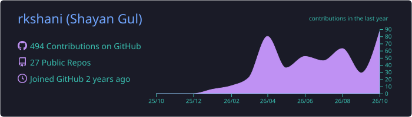
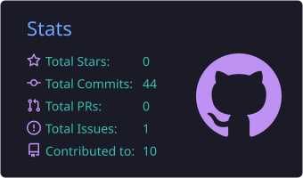
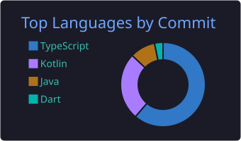

<!-- ===================== HEADER ===================== -->
<div align="center">


<a href="https://git.io/typing-svg">
  
</a>

<p>
  <a href="https://shayanshani.com"></a>
  <a href="https://www.linkedin.com/in/shayan-gul-208114231"></a>
  <a href="mailto:rkknight.47@gmail.com"></a>
</p>


</div>

<br/>

<!-- ===================== QUICK HIGHLIGHTS ===================== -->
<div align="center">

| 🗓️ **5+ Years** | 📲 **1M+ Users** | 🧱 **Clean Architecture** | 🌍 **Native + Flutter** |
|:---:|:---:|:---:|:---:|
| Building Android apps | Reached on Google Play | MVVM • Hilt • Room | One dev, both worlds |

</div>

<br/>

<!-- ===================== ABOUT ===================== -->
## 👨‍💻 About Me


```kotlin
data class Developer(
    val name: String     = "Shayan Gul (RK)",
    val role: String     = "Android Developer @ Binary Ops",
    val location: String = "Islamabad, Pakistan 🇵🇰",
    val experience: String = "5+ years",
    val stack: List<String> = listOf(
        "Kotlin", "Jetpack Compose", "MVVM",
        "Clean Architecture", "Hilt", "Room",
        "Coroutines", "Flutter"
    ),
    val focus: String    = "Apps people actually love to use",
    val openTo: String   = "Freelance & full-time roles ✅"
)
```

> *"Good code is invisible. Great UX is unforgettable."*

<br clear="right"/>

<!-- ===================== TECH STACK ===================== -->
## 🛠️ Tech Stack

<div align="center">


<br/>


<br/><br/>


</div>

<br/>

<!-- ===================== EXPERIENCE ===================== -->
## 💼 Experience

### 🏢 Android Developer — **Binary Ops** · *Aug 2022 – Present · Rawalpindi*
Built Android apps from scratch, maintained them, and supported apps with **100K+ active users**.

<table>
  <tr>
    <td width="50%" valign="top">
      <h4>🕌 Islamic Prayer Time</h4>
      Prayer times, Qibla direction, smart notifications, Duas and more.
    </td>
    <td width="50%" valign="top">
      <h4>🖼️ Photo Editor</h4>
      Filters, neon effects, background remover and 20+ editing tools.
    </td>
  </tr>
  <tr>
    <td valign="top">
      <h4>📲 Smart Switch</h4>
      Fast P2P data transfer between Android devices.
    </td>
    <td valign="top">
      <h4>📄 Images to PDF</h4>
      Convert images to PDF with encryption, rotation and font control.
    </td>
  </tr>
  <tr>
    <td valign="top">
      <h4>🏳️ Face Flag</h4>
      Put country flags on faces and track upcoming independence days.
    </td>
    <td valign="top">
      <h4>🌸 Period Tracker</h4>
      Fertility and ovulation tracking with smart reminders.
    </td>
  </tr>
</table>

### 🏢 Junior Android Developer — **Impact Software Solution** · *Feb 2022 – Aug 2022 · Peshawar*
- 🍔 **FoodyMoody** — Restaurant food ordering app (UI, order flow, bug fixes)
- 🛒 **PocketMRT** — Online grocery app (product listings, cart, UI improvements)

<br/>

<!-- ===================== STATS (self-generated, never breaks) ===================== -->
## 📊 GitHub Stats

<div align="center">






<br/>


</div>

<br/>

<!-- ===================== CONNECT ===================== -->
## 🤝 Let's Work Together

<div align="center">

**Have an Android or Flutter app idea? Let's build it.**

<a href="mailto:rkknight.47@gmail.com"></a>
<a href="https://shayanshani.com"></a>
<a href="https://www.linkedin.com/in/shayan-gul-208114231"></a>

</div>

<br/>

<!-- ===================== SNAKE (your own contributions) ===================== -->
<div align="center">
  <picture>
    <source media="(prefers-color-scheme: dark)" srcset="https://raw.githubusercontent.com/rkshani/rkshani/output/github-snake-dark.svg"/>
    
  </picture>
</div>


<div align="center"><sub>⭐ Thanks for visiting — <a href="https://github.com/rkshani">rkshani</a></sub></div>
